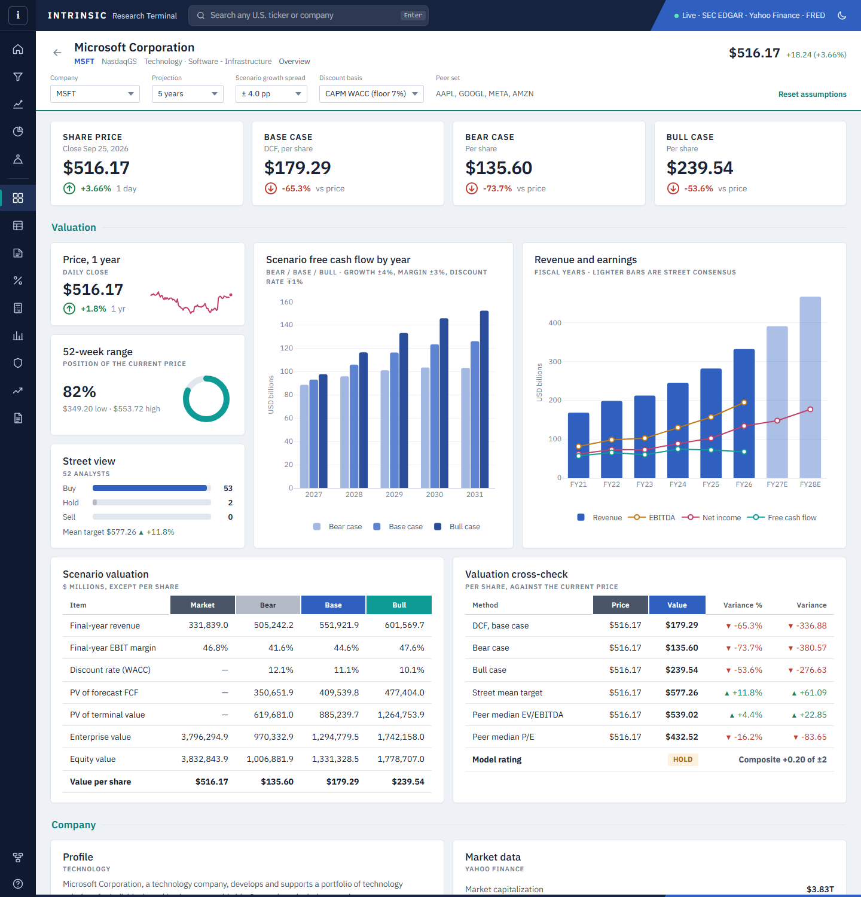
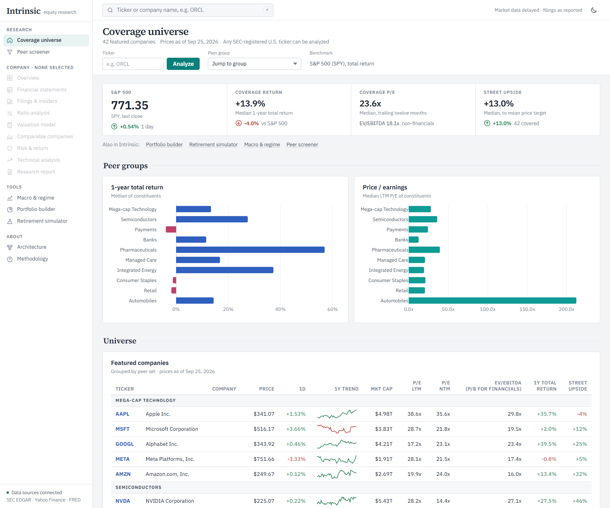
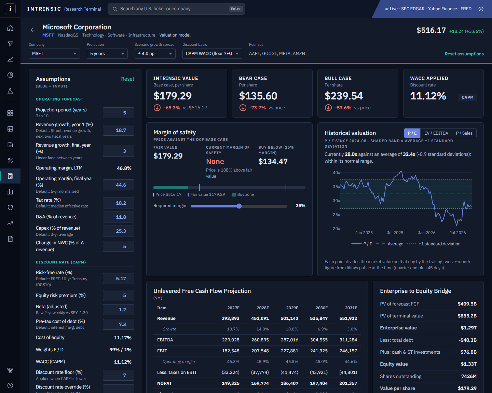
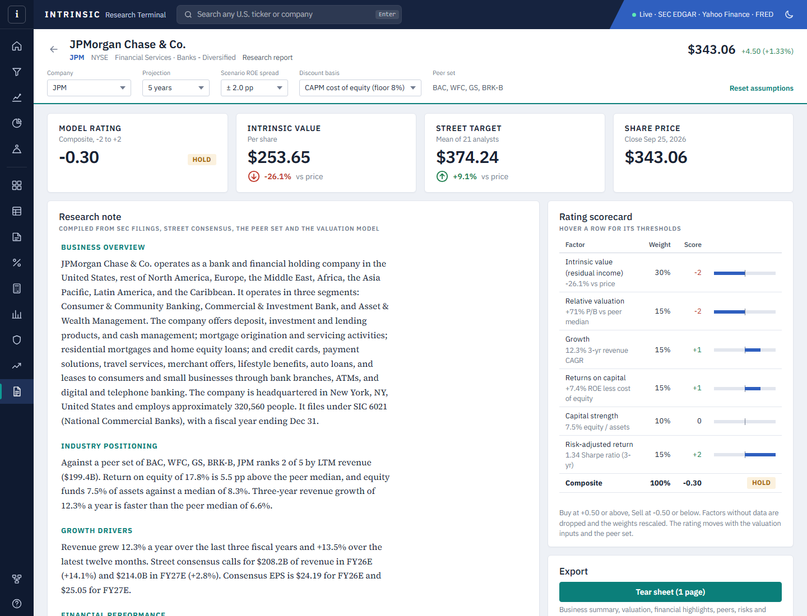
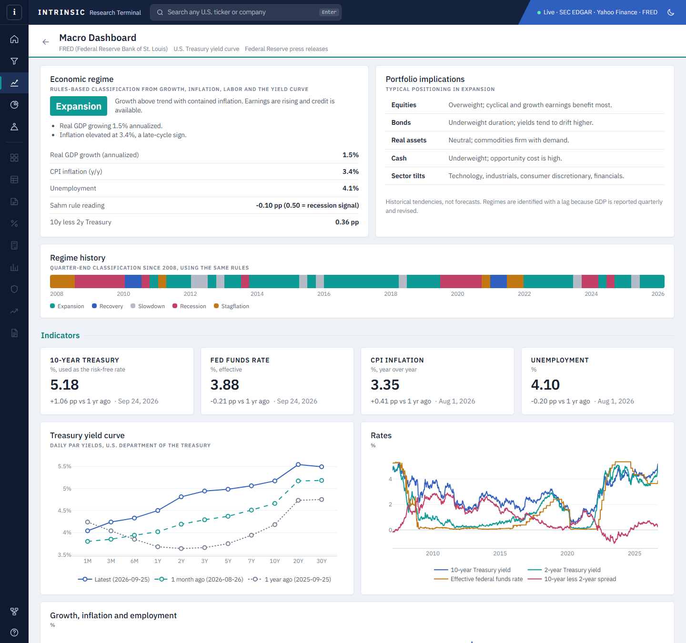
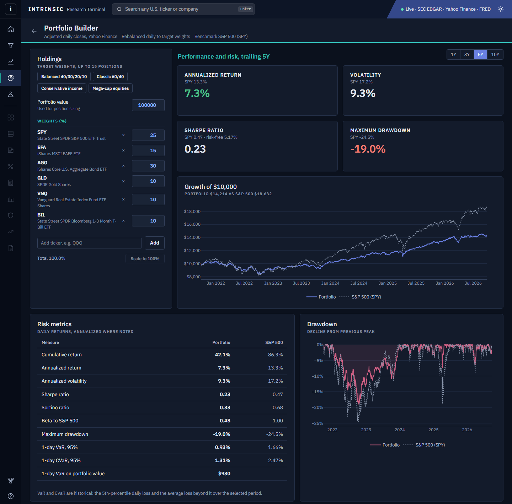
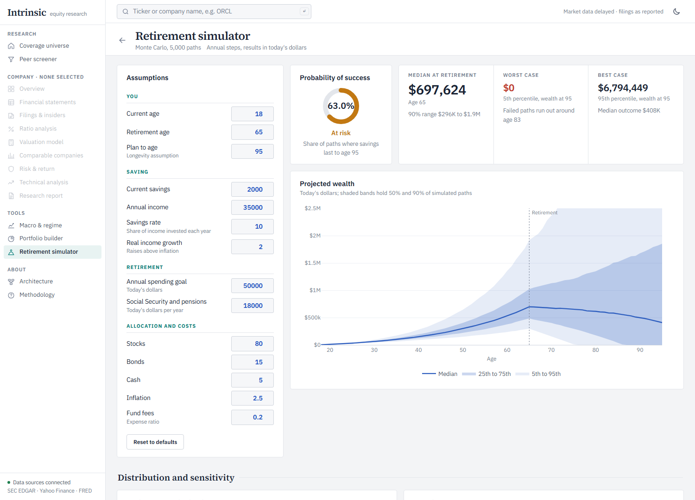
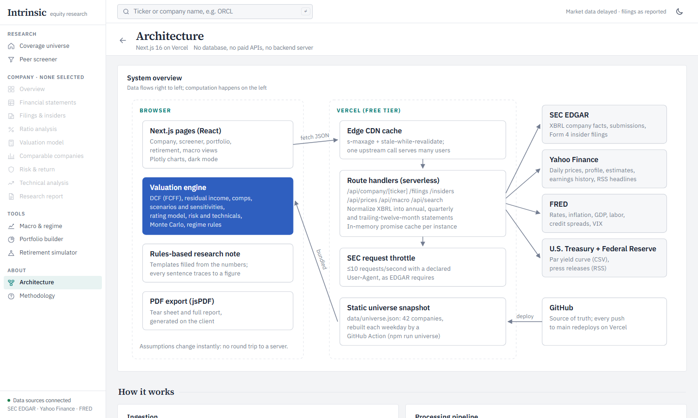

# Intrinsic

**Intrinsic recreates core equity research workflows from professional financial terminals using only public data and free infrastructure.**

**Live demo:** [intrinsic-terminal.vercel.app](https://intrinsic-terminal.vercel.app/)

Intrinsic is a full-stack equity research and valuation platform. Type any U.S. ticker and it pulls the company's filings from the SEC, market data from Yahoo Finance and macroeconomic data from the Federal Reserve. Within seconds it builds normalized financial statements, a discounted cash flow model with bull, base and bear cases, a peer comparison, risk and technical analysis, insider trading activity, and a written research note you can export as a PDF.

Instead of relying on proprietary terminals or paid APIs, Intrinsic uses transparent methods and publicly available sources. It runs entirely on GitHub and Vercel's free tier, with no database, no paid data and no AI model.



---

## Why this project exists

Individual investors usually have to switch between several disconnected sites to see a company's financial statements, market data, valuation, economic backdrop and insider activity. Professionals get all of that in one place, from terminals that cost tens of thousands of dollars a year.

I built Intrinsic to find out whether one platform, powered only by public data, could offer professional-grade research tools while staying free for students and individual investors.

## About me

Hi, I'm **Noah Williams**. Online I go by **Dysmas Anastasiou**. I'm 18, and I built this by myself.

My high school transcript doesn't tell the whole story. I left the group home system in 2022. For a long time after that I was dealing with depression, anxiety and symptoms close to schizophrenia, and my grades went down with me. I didn't want that transcript to be the last word on what I can do, so I decided to build real things and use them to earn a place at a university.

Intrinsic is the biggest of those projects. I built it to explore software engineering, financial analysis and the infrastructure behind wealth management, and I wanted it to be honest about where every number comes from.

---

## Technical highlights

- **Normalized SEC XBRL filings into a common data model.** Raw tagged facts become annual, quarterly and trailing-twelve-month statements, with year-to-date differencing, tag fallbacks, restatement handling and merged predecessor filers.
- **Parsed SEC Form 4 filings** into insider transactions, separating open-market buying and selling from compensation events.
- **Built a valuation engine that runs in the browser:** an unlevered DCF for operating companies and a residual income model for banks and insurers. It uses a CAPM discount rate from the live 10-year Treasury yield, scenario analysis and sensitivity grids.
- **Wrote a deterministic research-note generator** and a six-factor Buy/Hold/Sell rating. Every sentence is built from a computed figure.
- **Implemented a Monte Carlo retirement simulator** with correlated asset returns (Cholesky factorization, seeded random numbers) and a portfolio risk engine (Sharpe, Sortino, VaR, CVaR, risk contribution).
- **Classified economic regimes** from GDP, inflation, the Sahm rule and the yield curve, and backtested the rules quarterly since 2008.
- **Designed a serverless architecture on free infrastructure,** with CDN caching, in-memory request deduplication, an SEC rate limiter and a daily GitHub Actions data refresh.

---

## What it does

| | |
|---|---|
| **Company analysis** | Search any SEC-registered U.S. ticker. Get the overview, 52-week range, analyst consensus, earnings dates and surprises, and a company profile. |
| **Financial statements** | Income statement, balance sheet and cash flow built from raw XBRL filings. Annual and quarterly, plus trailing twelve months. |
| **Ratio analysis** | Profitability, returns, liquidity, leverage, efficiency and per-share trends. Nonsense values (such as margins of -50,000% for pre-revenue companies) are flagged instead of plotted. |
| **Valuation model** | DCF and residual income models with bull, base and bear scenarios, sensitivity grids, a margin-of-safety slider, and historical P/E, EV/EBITDA and P/S bands. Every assumption can be edited. |
| **Peer benchmarking** | Peer multiples and operating metrics against a peer set you can change. |
| **Risk and technicals** | Beta, volatility, drawdowns, Sharpe and Sortino, VaR, moving averages, RSI, MACD and volume. |
| **Filings and insiders** | Recent 10-K, 10-Q and 8-K filings with direct links, plus Form 4 insider trades with net buying and selling. |
| **Research report** | Rules-based note covering business, positioning, growth, financials, valuation, risks and thesis, with a six-factor rating. Exports as a one-page tear sheet or a full PDF report. |
| **Portfolio builder** | Preset or custom allocations. See position sizing, return and risk contribution, the correlation matrix, and asset-class and sector exposure against the S&P 500. |
| **Retirement simulator** | 5,000-path Monte Carlo that estimates the chance your savings last, shows best and worst cases, and finds the savings rate you need. |
| **Macro and regime** | Classifies the economy as Expansion, Recovery, Slowdown, Recession or Stagflation, and shows what each regime has meant for stocks, bonds, real assets and sectors. |
| **Screener** | A 42-company coverage universe across 10 industries, sortable and comparable side by side. |

---

## Screenshots

| | |
|---|---|
|  |  |
| **Coverage universe:** peer groups, the screener and quick tools | **Valuation model (dark mode):** editable DCF, margin of safety and historical P/E band |
|  |  |
| **Research report:** rules-based note and rating scorecard | **Macro dashboard:** economic regime, implications and the Treasury curve |
|  |  |
| **Portfolio builder:** risk metrics, drawdown and position sizing | **Retirement simulator:** Monte Carlo probability of success |

---

## Architecture

```
User
 │
 ▼
Next.js App Router (browser)
 ├── Company research        overview, statements, ratios, filings, insiders
 ├── Valuation engine        DCF, residual income, scenarios, rating
 ├── Portfolio builder       risk metrics, exposures, correlations
 ├── Retirement simulator    Monte Carlo
 ├── Macro dashboard         regime classification, yield curve
 └── Research reports        rules-based note, PDF export
 │
 ▼
Vercel CDN cache  (s-maxage + stale-while-revalidate)
 │
 ▼
Server route handlers (TypeScript, serverless)
 ├── SEC EDGAR               XBRL company facts, submissions
 ├── SEC Form 4              insider transactions
 ├── Yahoo Finance           prices, profile, estimates, earnings, news
 ├── FRED                    rates, inflation, GDP, labor, credit, VIX
 ├── U.S. Treasury           daily par yield curve
 └── Federal Reserve RSS     press releases

GitHub Actions ──► data/universe.json (daily snapshot of the coverage universe)
```



- **No backend server.** The API is a set of Next.js route handlers deployed as serverless functions alongside the site.
- **Valuation runs in the browser,** so changing an assumption updates the model instantly.
- **Three layers of caching** keep it free to run: Vercel's CDN, a per-instance in-memory cache, and a static snapshot of the coverage universe.

The app includes an [Architecture page](app/architecture/page.tsx) with the full diagram and a walk-through of ingestion, processing, caching and the valuation engine.

## Design philosophy

**Transparency.** Every figure on the page traces back to a filing, a market data point or a stated assumption.

**Free data first.** All core features work with publicly available information and free infrastructure.

**Deterministic analysis.** Research notes and ratings come from rules applied to measured financial data, not from a language model. The same inputs always give the same output.

**Explainability.** Every assumption, valuation input, financial adjustment and economic indicator is visible and, where it makes sense, editable.

### Tech stack

| Layer | Tools |
|---|---|
| Framework | Next.js 16 (App Router), React 19, TypeScript |
| Styling | Tailwind CSS 4, IBM Plex Sans, Source Serif 4, light and dark themes |
| Charts | Plotly.js with colorblind-safe palettes |
| PDF | jsPDF and jspdf-autotable |
| Hosting | Vercel (Hobby), GitHub, GitHub Actions |

### Data sources

| Source | Used for | Status |
|---|---|---|
| SEC EDGAR (XBRL company facts, submissions) | Financial statements, filing history, company metadata | ✅ Live |
| SEC Form 4 | Insider buys, sells and holdings | ✅ Live |
| Yahoo Finance | Prices, profile, analyst estimates, earnings calendar and surprises, news RSS | ✅ Live |
| FRED | Risk-free rate, CPI, GDP, unemployment, credit spreads, VIX | ✅ Live (free key) |
| U.S. Treasury | Daily par yield curve | ✅ Live |
| Federal Reserve | Press releases (RSS) | ✅ Live |
| Financial Modeling Prep, Finnhub | Segment data, transcripts, more estimates | 🔜 Planned (free keys) |
| SEC N-PORT, ETF holdings | Fund look-through for the portfolio builder | 🔜 Planned |

---

## Engineering constraints and lessons learned

The project had a budget of zero, and several of its best design decisions came from that.

### Infrastructure

The original architecture used a Python API (FastAPI and EdgarTools) deployed on Oracle Cloud's free tier. Oracle requires a credit card to sign up, which I don't have, so I redesigned the backend around Vercel route handlers in TypeScript and rebuilt the parts of EdgarTools I needed (XBRL normalization and Form 4 parsing). The result is simpler: one repository, one deployment, and no server to maintain.

### Research notes without a language model

The first design used the OpenAI API to write research notes. Without a budget for API usage, I built a deterministic, rules-based generator instead. It turned out to be the better design for financial research: every sentence is backed by a computed figure, it can't make a number up, and it costs nothing to run.

### Data reliability

Yahoo Finance is free but unofficial and can change without notice, so every Yahoo field is optional and the core analysis still works from SEC data alone. I evaluated Stooq as a second price source, but it now puts automated requests behind a bot check, so I left it out rather than work around that.

### Letting the model disagree with the market

The valuation model isn't tuned to agree with market prices. When a company's free cash flow is squeezed (as with Microsoft's AI data-center spending in 2026), the DCF says so, and the page shows exactly which inputs drive the result. A model that always agrees with the price isn't telling you anything.

---

## Run it locally

You need Node.js 20 or newer.

```bash
git clone https://github.com/btx-dysmas/intrinsic-terminal.git
cd intrinsic-terminal
npm install
cp .env.example .env.local   # then fill in the two values
npm run dev
```

Open http://localhost:3000.

| Variable | Required | What it is |
|---|---|---|
| `SEC_USER_AGENT` | Yes | Your name and email, e.g. `Jane Doe jane@example.com`. The SEC requires this on every request. |
| `FRED_API_KEY` | Recommended | Free key from [fred.stlouisfed.org](https://fred.stlouisfed.org/docs/api/api_key.html). Without it, macro pages are disabled and valuations use a 4.25% risk-free rate. |

To refresh the coverage universe snapshot:

```bash
npm run universe
```

## Deploy (free)

1. Push the repo to GitHub.
2. Import it at [vercel.com/new](https://vercel.com/new). The defaults for Next.js are correct.
3. Add `SEC_USER_AGENT` and `FRED_API_KEY` under **Settings → Environment Variables**.
4. Optional: add the same two values as GitHub repository secrets. The workflow in `.github/workflows/universe.yml` then refreshes the universe snapshot every weekday.

## Project structure

```
app/                 pages and API route handlers
  api/               company, prices, macro, search, health
  company/[ticker]/  company views (overview, financials, valuation, ...)
components/          shell, UI primitives, charts, company views
lib/                 valuation models, portfolio and Monte Carlo math, regime rules, PDF, formatting
lib/server/          SEC, Yahoo, FRED and Treasury clients, XBRL normalization, caching
scripts/             universe snapshot builder
data/                universe.json (generated)
```

## Roadmap

- Segment revenue and earnings-call transcripts (Financial Modeling Prep or Finnhub free tiers)
- ETF look-through in the portfolio builder (SEC N-PORT)
- Saved watchlists shared by URL
- More peer groups in the coverage universe

---

## Disclaimer

Intrinsic is an educational project. Its models are quantitative screens, not investment advice.

## Author

**Noah Williams** (Dysmas Anastasiou)
Email: nwfootball07@gmail.com
